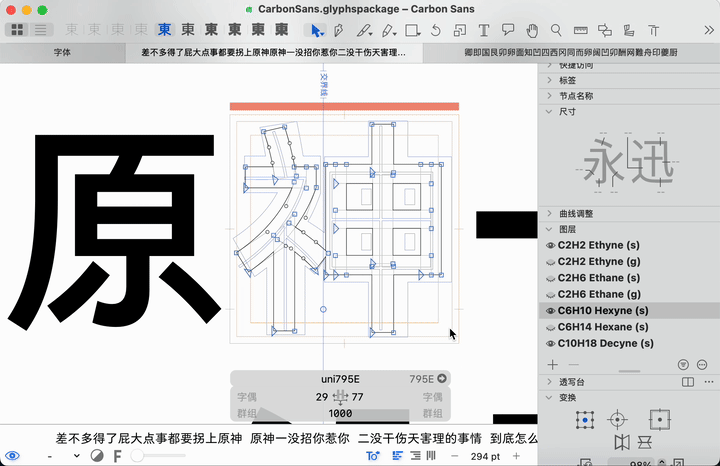

# 字统，启动！ Zi.tools Impact

	

这个 Glyphs 插件只做一件事，接管信息面板中「跳转到 UnicodeChecker」的功能，在当前字符为汉字时，启动字统网，而非 UnicodeChecker。

この Glyphs プラグインは、情報パネルの「UnicodeChecker で表示」ボタンの機能を引き継ぎます。選択した文字が漢字の場合は、UnicodeChecker の代わりに字統（zi.tools）を起動します。

This Glyphs plugin does one simple thing: it takes over the "Show in UnicodeChecker" button in the info panel. If the selected character is a Han character, it opens ZiTools instead of UnicodeChecker.

## 使用 Usage

下载本仓库，双击安装 `ZiToolsImpact.glyphsPlugin`，重启 Glyphs 即可。

このリポジトリをダウンロードし、`ZiToolsImpact.glyphsPlugin` をダブルクリックしてインストールしてください。Glyphs を再起動すると、プラグインが利用可能になります。

Download this repository and double-click `ZiToolsImpact.glyphsPlugin` to install. After restarting Glyphs, the plugin will be ready to use.
